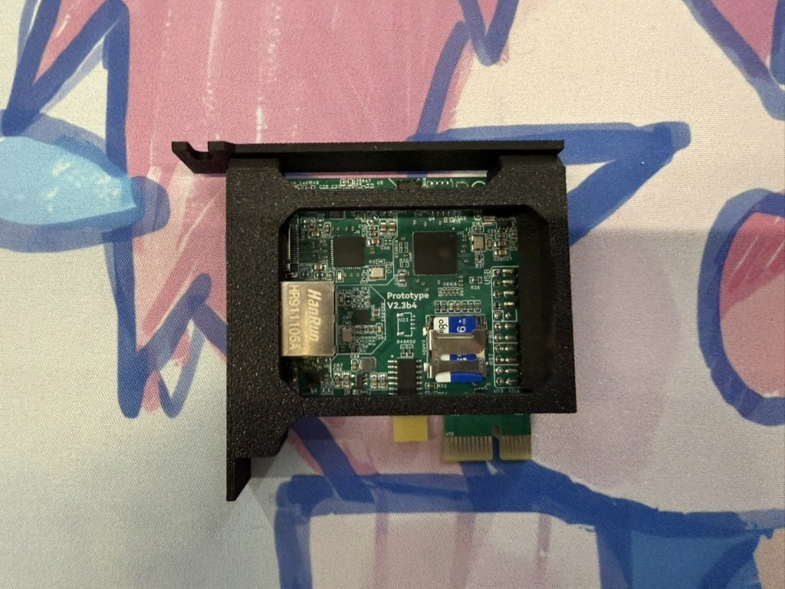

# ExoAnchor

**An Another [RCOS](https://rcos.io/) project**

**[中文](README_zh.md)**

ExoAnchor is a fully featured KVM released under the [MIT License](LICENSE),
with the goal of opening everything from firmware to fabrication. It is an MCU-
and RTOS-based embedded hardware project with an optional AI Agent layer.

> Current development firmware: `0.87.6-dev IndigoShore`.

**We commit to releasing everything, from R&D to manufacturing, under the MIT
License.**

ExoAnchor keeps a physical machine reachable when its operating system, SSH
access, network stack, or services are unavailable. Through an independent
network path you can still see the screen and send keyboard and mouse input,
with UART, reset, and power control on boards that actually implement them.

The target machine does not need ExoAnchor software. Manual KVM always remains
independently usable; the device API, embedded Agent, and external MCP
controller are optional layers above that deterministic control plane.

ExoAnchor started in the RCOS community at Rensselaer Polytechnic Institute. At
first we only wanted an affordable KVM for remote maintenance and recovery of lab
and personal machines. The mature products that fit were over our budget, and
their closed hardware and software made customization, repair, and further
development hard. So we decided to build our own from scratch.

The first goal was simple: reliable video capture, keyboard and mouse control,
power management, and remote recovery at the lowest possible cost. As
development went on, ExoAnchor stopped being just a cheaper alternative and
became a long-running experiment in open hardware, embedded systems, and
intelligent control of real devices.

ExoAnchor currently centers on the ESP32-P4, with an MCU and RTOS carrying the
core KVM functions. More hardware platforms may follow, as long as they preserve
the same control plane and safety model. The AI Agent is an optional control
layer built on top of the device's capabilities, never a prerequisite for the
device to work; every action on a real device must have explicit permission
boundaries and stay under human authorization and supervision.

For ExoAnchor, "open source" is not a marketing label. It means opening the
complete set of materials from R&D to manufacturing: software, firmware,
schematics, PCB source projects, BOMs, netlists, mechanical CAD source projects,
reproduction guides, and the related design documents.

We do not intend to put artificial knowledge barriers in front of manufacturing,
modification, or commercial use. If a design truly belongs to the open
community, anyone should be able to reproduce it and understand why it was
designed this way and how it works.

As AI Agents become common, we want this low-cost, fully open KVM to reach more
people, and to show that Agents do not live only in browsers and software APIs:
with explicit authorization and supervision, they can also perceive, operate,
and take over real devices.

## Open from firmware to fabrication

**Not just open firmware. Open from firmware to fabrication.**

The table lists, layer by layer, what is actually published and its current
status. All original ExoAnchor files are distributed under the MIT License, so
anyone can inspect, modify, reproduce, manufacture, and sell their own hardware.

| Layer | Published material | Current status |
| --- | --- | --- |
| Application and control plane | Dashboard, device API, embedded Agent, and optional MCP adapter | ✅ Published and under active development |
| MCU firmware | Video, HID, networking, UART, power control, configuration, and build scripts | ✅ Stable and Dev source published |
| Schematics and PCB | Schematic PDF, native JLCEDA Pro project, KiCad project, and PADS / Altium reference exports | ✅ V2.4a6 published (V2.3B4/B6 kept as historical projects); manufacturing sign-off pending |
| BOM, netlist, and reproduction guide | Versioned BOM, Protel 2.0 netlist, and build, flashing, assembly, and acceptance instructions | ✅ BOM and netlist published; 🚧 the reproduction guide is being expanded |
| EasyEDA cloud source project | [Online V2.4a6 schematic and PCB source project](https://oshwhub.com/team_dsksgpyk/project_akawewur) | ✅ Public (MIT); 🚧 online design preview not generated yet |
| Mechanical design | Editable mechanical CAD source projects | ⏳ Pending |

> ⚠️ This project is still under active development and hardware validation.
> Review everything carefully before use, reproduction, or manufacturing, and
> please report problems through
> [GitHub Issues](https://github.com/wxffxx/ExoAnchor/issues).

This is an open-materials commitment, not a statement that everything is already
open source: nothing is released until it has been verified and checked. The
[ExoAnchor-Hardware repository](https://github.com/wxffxx/ExoAnchor-Hardware)
is authoritative for what each hardware revision has actually published and how
far it has been validated. Publishing schematics, PCB projects, and
manufacturing materials does not mean production validation is complete;
reproduction and acceptance must follow the guide and validation state for that
revision.

## Core capabilities

| Capability | Description |
| --- | --- |
| Video | Captures the target's HDMI output through an MS2109-class UVC path |
| Keyboard and mouse | Emulates USB HID across BIOS, boot, and OS stages |
| Independent network | The ESP32-P4 serves the Dashboard and device API over its own Ethernet |
| Secure access | HTTPS only; the administrator account is created in the web UI on first boot; optional two-step verification and passkey login |
| UART | Target serial only on boards where it is actually wired and verified |
| Power and status | PWR, RST, 12V, and 3V3AUX only on boards that implement those circuits |
| Embedded Agent | Orchestrates observations and actions under firmware policy, request approval, and control leases |
| External control | The optional MCP adapter uses the device API directly and never takes over embedded Agent state |

Each board reports only its own real capabilities. A buildable profile, a draft
schematic, or test results from another board are not evidence for the current
hardware.

## Hardware baseline

We offer both an integrated PCIe-form-factor board of our own design and a
simple DIY build made entirely from off-the-shelf parts, with no soldering and
no unusual tools.

| # | Implementation | Status | Role |
| ---: | --- | --- | --- |
| 1 | ESP32-P4 development board + external USB HDMI capture card | ✅ Early prototype, all materials open-sourced | Off-the-shelf parts |
| 2 | Waveshare ESP32-P4-NANO + simple expansion board | ✅ Early prototype, all materials open-sourced | Off-the-shelf parts |
| 3 | ExoAnchor PrototypeV0 | ✅ Fully verified | Core KVM feasibility board |
| 4 | ExoAnchor PrototypeV2.3 | ✅ Fully verified | Integrated PCIe control board |
| 5 | ExoAnchor PrototypeV2.4 / V2.4a6 | ✅ Fully verified | Integrated PCIe control board |
| 5A | ExoAnchor PrototypeV2.4C | 🚧 Verification in progress | HDMI2CSI feasibility board |

<p align="center">
  
  <br>
  <sub>ExoAnchor PrototypeV2.3b4 in its PCIe bracket enclosure</sub>
</p>

See the [ESP32-P4 platform overview](device/ESP32P4/README.md). The
[ESP32-P4 implementation matrix](device/ESP32P4/boards/IMPLEMENTATION_PROFILES_zh.md)
records each board's firmware profile, ESP32-P4 revision, and validation status.

V2.4 and V2.4a6 share `exoanchor-prototype-v2.4 + esp32p4-rev3`; the
[implementation matrix](device/ESP32P4/boards/IMPLEMENTATION_PROFILES_zh.md#自研板电气基线)
explains why. The separate `exoanchor-prototype-v2.4-ms-test` profile exposes
destructive EEPROM test controls and is not a product image.

## From hardware selection to flashing

### 1. Choose hardware, firmware, and toolchain

| Hardware | Firmware | Build combination | ESP-IDF | Entry |
| --- | --- | --- | --- | --- |
| Waveshare ESP32-P4-NANO DIY | Dev; pure-KVM Stable is also available | `waveshare-p4-nano + esp32p4-rev1` | 5.4.x | [Assembly and flashing guide](https://github.com/wxffxx/ExoAnchor-Hardware/tree/main/ESP32P4/simple-diy/waveshare-nano-diy) |
| ExoAnchor PrototypeV0 | Dev or Stable | `exoanchor-prototype0 + esp32p4-rev3` | 5.5.5 for both Dev and Stable | [Dev build](device/ESP32P4/firmware/v0.86.6-dev/README.md#prototype0rev3已验证参考) · [Stable build](device/ESP32P4/firmware/v0.86-stable-kvm/README.md#构建-prototype0) |
| ExoAnchor PrototypeV2.3 | Dev | `exoanchor-prototype-v2.3 + esp32p4-rev3` | 5.5.5 | [V2.3 build](device/ESP32P4/firmware/v0.86.6-dev/README.md#prototypev23rev3已完全验证) |
| ExoAnchor PrototypeV2.4 / V2.4a6 | Dev | `exoanchor-prototype-v2.4 + esp32p4-rev3` | 5.5.5 | [V2.4 build and capability boundary](device/ESP32P4/firmware/v0.86.6-dev/README.md) |

Dev is the current KVM + embedded Agent development line and runs `0.87.6-dev`;
Stable is an independent pure-KVM source line without the embedded Agent. See
the [firmware version index](device/ESP32P4/firmware/README.md) for all
versions, upgrade requirements, and entry points.

Different boards and chip revisions must not share `sdkconfig` or build
directories. Confirm the physical board before flashing, and never flash a
default configuration onto unverified hardware.

### 2. Ask an AI Agent to get the source, build, and flash

Connect the board's development/flashing USB port, start Codex or another
terminal-capable AI Agent in the directory where the project should be stored,
and copy the prompt below. Replace the bracketed hardware and firmware values
first. If the serial port is unknown, request read-only discovery and do not
authorize flashing until an explicit port and the complete board identity are confirmed.

```text
Get ExoAnchor from its public repository and help me reproduce, build, and flash a device.

My environment:
- Hardware: [Waveshare ESP32-P4-NANO DIY / ExoAnchor PrototypeV0 / ExoAnchor PrototypeV2.3 / ExoAnchor PrototypeV2.4 or V2.4a6]
- Firmware: [Dev / Stable KVM]
- Operating system: [macOS / Linux / Windows]
- Flashing port: [actual port / unknown — discovery only, no flashing]
- Source location: [create ExoAnchor in the current directory / use an existing ExoAnchor directory]

Complete this task:
1. If the selected location has no source checkout, run git clone https://github.com/wxffxx/ExoAnchor.git. If a repository already exists, confirm that it is ExoAnchor and preserve all local changes.
2. Enter the repository and read README_zh.md, device/ESP32P4/firmware/README.md, and the README in the selected firmware directory.
3. Determine the one correct board profile, chip-revision overlay, and ESP-IDF version from the physical hardware. Code and configuration are authoritative. Stop instead of guessing when the board cannot be identified.
4. Check the local ESP-IDF and serial environment. State the exact required version when the toolchain is missing, and ask before making any system-level installation.
5. Preserve all existing workspace changes. Do not run git reset, overwrite with checkout, force-pull, or perform destructive cleanup.
6. Create a separate build directory and sdkconfig for the selected board, then run set-target and a complete build. Never reuse generated configuration from another board.
7. If the build fails, diagnose the first actionable error and fix only issues clearly in scope. Do not bypass failures by disabling safety checks or selecting another board profile.
8. Identify candidate serial ports and chip information with read-only checks. Before any write, require the operator-confirmed physical model, exact CH343 USB serial, eFuse MAC, silicon revision, firmware profile, and an explicit unoccupied port to match the board identity record. Stop on any missing value or mismatch.
9. Only after the build and full identity record match the hardware, run tools/flash-monitor.sh with the explicit port and --build-dir to perform a complete wired flash, monitor serial output, and extract the DHCP address. Never pass an auto-selected port to a write command.
10. Report the source commit, firmware version, board, chip revision, ESP-IDF version, build directory, serial port, device IP, Ethernet/UVC/HID startup state, and every error.

Safety constraints:
- Do not send keyboard, mouse, power, or reset actions to the target host.
- Do not use force, erase the entire Flash, or overwrite another board's build directory without my explicit approval.
- Do not print or add passwords, tokens, private keys, or absolute local credential paths to shared documentation.
```

### 3. Get the source, build, and flash manually

```bash
git clone https://github.com/wxffxx/ExoAnchor.git
cd ExoAnchor
```

Install the ESP-IDF version from the selection table, then follow the
[Dev build guide](device/ESP32P4/firmware/v0.86.6-dev/README.md) or the
[Stable build guide](device/ESP32P4/firmware/v0.86-stable-kvm/README.md) for the
selected firmware and board. After the build, flash from the selected firmware
directory as described in the
[firmware flashing rules](device/ESP32P4/firmware/README.md#烧录规则):
`--build-dir` must exactly match the `idf.py -B` argument used during the build,
and the port must be the one the operating system actually reports.

### 4. Open and verify

| URL | Purpose |
| --- | --- |
| `https://<board-ip>/` | Dashboard |
| `https://<board-ip>/kvm` | Video, keyboard, and mouse |
| `https://<board-ip>/agent` | Embedded Agent, Dev only |
| `https://<board-ip>/terminal` | Target UART, Dev only and board-dependent |
| `https://<board-ip>/settings` | Device settings |

On first access, in order:

1. Trust the device certificate as described in the
   [HTTPS pairing guide](docs/guides/SECURITY_TRANSPORT_zh.md);
2. Create the administrator account in the web UI on a trusted local network
   (official builds ship no bootstrap credential);
3. Confirm that the Dashboard opens, Ethernet has an address, KVM shows video,
   and HID works;
4. Optional: enable [two-step verification](docs/guides/TWO_STEP_zh.md), or sign
   in with a [passkey](docs/guides/PASSKEY_zh.md) from Apple or another
   compatible authenticator (requires a trusted HTTPS hostname).

## Repository layout

```text
ExoAnchor/
├── assets/
│   ├── brand/                       # Brand and Web assets
│   └── photos/                      # Hardware photos
├── device/ESP32P4/
│   ├── boards/                      # Authoritative board/profile mapping
│   └── firmware/                    # Independent Stable and Dev trees
├── docs/
│   ├── reproduction/                # Manufacturing and reproduction
│   ├── guides/                      # Practical and security guides
│   └── protocols/                   # Protocol designs
├── integrations/exoanchor-mcp/      # Optional external MCP controller
│   ├── exoanchor_mcp/               # Canonical stdio server
│   └── skills/exoanchor-mcp-control/ # Shared Codex and DSH operating skill
├── toolkit/                         # Desktop and CLI Toolkit (discovery, network setup, firmware download and OTA)
├── scripts/                         # Repository checks (check-all.sh and friends)
└── LICENSE

ExoAnchor-Hardware/                  # Independent hardware source repository
├── ESP32P4/
│   ├── exoanchor-p4-v2.4a6/         # Current integrated PCIe board (JLCEDA + KiCad)
│   ├── exoanchor-p4-v2.3b4/         # Four-layer V2.3, historical
│   ├── exoanchor-p4-v2.3b6/         # Six-layer V2.3, historical
│   ├── simple-diy/                  # Off-the-shelf simple DIY designs
│   └── archive/                     # Historical hardware material
├── assets/brand/
└── LICENSE
```

`ExoAnchor-Hardware` is an
[independent hardware repository](https://github.com/wxffxx/ExoAnchor-Hardware)
alongside this one, not a subdirectory of `ExoAnchor/`. Browse the
[documentation map](docs/README.md).

## Development verification

Run the complete host-only gate from the repository root:

```bash
./scripts/check-all.sh
```

It covers host tests and security runtime tests for both firmware trees, MCP,
Toolkit, copy-parity checks, documentation and repository hygiene, and Git
whitespace checks. The whole gate needs Python 3.10+; when `uv` is available,
the Toolkit uses its locked environment automatically. It does not replace board
HIL.

## AI use disclosure

ExoAnchor makes extensive use of AI Agents in development. AI took part in
writing code and documentation, testing, organizing hardware material, reviewing
schematics, research, and creating visual assets.

Using AI does not change the licensing or responsibility boundaries of any
contribution.

## License

Original ExoAnchor software, firmware, and documentation are licensed under the
[MIT License](LICENSE). Unless a file says otherwise, this license covers all
original materials that the ExoAnchor contributors have the right to license,
including software, firmware, scripts, tests, configuration, documentation,
specifications, diagrams, original media assets, schematics, PCB and CAD source
projects, BOMs, netlists, mechanical models, and manufacturing materials, and it
permits manufacturing and selling hardware from the covered design files.

Copies or substantial portions must retain the copyright and permission notice
from `LICENSE`. Third-party products and materials keep their own terms, and
file-specific notices take precedence. The MIT License does not grant rights to
ExoAnchor names, logos, trademarks, or third-party material, and does not imply
regulatory approval, safety certification, or fitness for a particular hardware
application. Covered materials and hardware made from them are provided **as
is**, without warranty, to the fullest extent permitted by law.

This project does not provide any material on the MS2109 or LT6911UXC: it is not
public, and its distribution is restricted by the chip vendors.

### Why MIT All?

I do not depend on this project for income. I have my own research agenda, and
ExoAnchor is, in a sense, a semi-hobby project. That gives me the freedom to
open-source all of it.

Being fully open source does not mean that we will not release production
hardware. We will bring out a practical version that people can purchase and
use as soon as possible.

More than anything, I hope people can learn from ExoAnchor how to turn an idea
into a product. I believe that lesson is worth more than the project itself.

## Acknowledgements

Many thanks to [JLCPCB](https://jlcpcb.com/) for supporting this project with
funding, materials, and manufacturing.

ExoAnchor's schematics and PCBs are designed in EasyEDA Pro, and the boards are
fabricated and assembled by JLCPCB. JLCPCB offers one-stop hardware
manufacturing, from PCB prototyping and SMT assembly to component sourcing, 3D
printing, and CNC machining. If you want to build your own ExoAnchor, you can
order it directly from JLCPCB.
